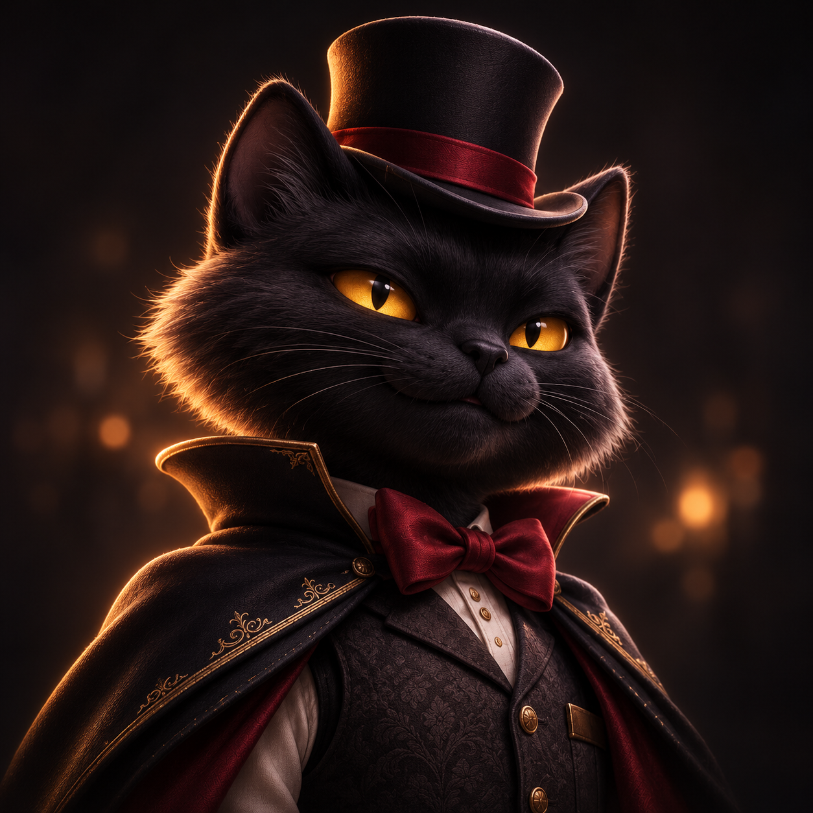
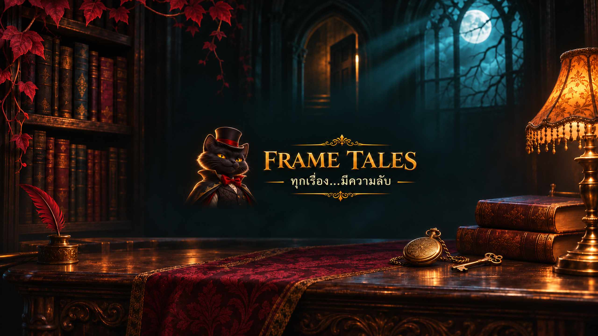
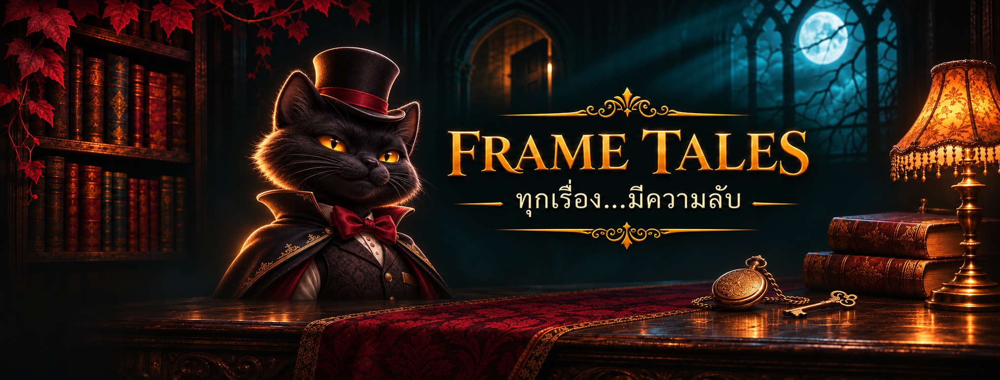

# Frame Tales — ภาพโปรไฟล์และแบนเนอร์

ชื่อช่อง **Frame Tales** / มาสคอต **NOX**

ภาพสร้างด้วย ChatGPT โดยอ้างอิง NOX character sheet ที่ผู้ใช้แนบ ใช้โทนดำ อำพัน และแดงเลือดหมู ข้อความในภาพคือ FRAME TALES และ ทุกเรื่อง…มีความลับ

## รูปโปรไฟล์ร่วม YouTube / Facebook

[เปิดไฟล์โปรไฟล์](assets/Frame_Tales_NOX_Profile.png) — 1254×1254 PNG

## YouTube Banner

[เปิดไฟล์ YouTube Banner](assets/Frame_Tales_YouTube_Banner_2560x1440.png) — 2560×1440 PNG ประมาณ 5.74 MB ขยายส่งออกจาก master ที่เจน ไม่ใช่การอ้างความละเอียดต้นทาง 2560 โดยตรง จัดหน้า ชื่อ และหมวกไว้กลางภาพเพื่อลดการถูกครอป ตรวจ preview บนมือถือใน Studio ก่อนกด Publish

## Facebook Cover

[เปิดไฟล์ Facebook Cover](assets/Frame_Tales_Facebook_Cover.png) — 2033×773 PNG ปรับตำแหน่งเมื่ออัปโหลดและตรวจทั้งมือถือและเดสก์ท็อป

## บันทึกไฟล์
เปิดไฟล์ภาพใน GitHub แล้วใช้ Download raw file หรือเปิด Raw แล้วบันทึกภาพ PNG อย่าบันทึกหน้าเว็บเป็นภาพ

## วิธีนำขึ้นช่อง
- YouTube Studio → Customization / การปรับแต่งช่อง → Profile / โปรไฟล์ (หรือหมวด Branding ตามหน้าจอ) → เปลี่ยน Picture และ Banner image → ตรวจการครอป → Publish
- Facebook → สลับไปใช้เพจ → เปลี่ยนรูปโปรไฟล์ → อัปโหลดไฟล์ NOX → จัดวงกลมและบันทึก จากนั้นแก้ไขภาพปก → อัปโหลดไฟล์ cover → จัดตำแหน่งและบันทึก

การตั้งค่าเหล่านี้ยังไม่ได้ทำกับบัญชีจริง เครื่องมือ Metricool ที่เชื่อมในแชตนี้ยังไม่มีคำสั่งเปลี่ยนโปรไฟล์/ภาพปก จึงต้องอัปโหลดผ่านหน้าช่อง

แบบแบนเนอร์ก่อนปรับพื้นที่มือถือเก็บอยู่ในต้นทาง generated_images แต่ไม่ใช่ไฟล์ที่แนะนำให้อัปโหลด YouTube ให้ใช้ไฟล์ 2560×1440 ในโฟลเดอร์นี้
