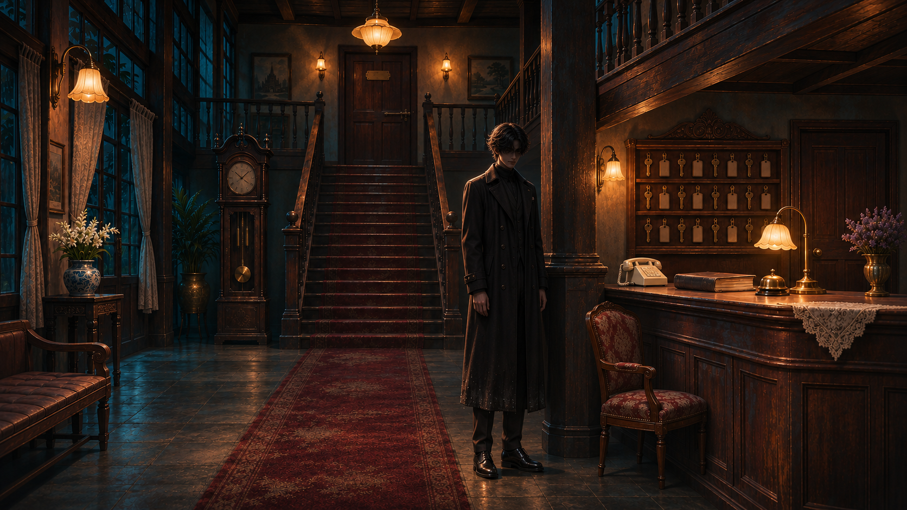

# ตรวจภาพชุด 01

[กลับหน้ารวม](README.md)

ผู้ใช้อนุญาตให้นำภาพที่ตรวจแล้วไปตัดต่อได้ เวอร์ชันที่เลิกใช้แยกอยู่ใน archive

## B01_contract — เมษาเซ็นสัญญาและรับเครื่องแบบ

[เปิดภาพต้นฉบับ](../assets/B01_contract.png)

## B02_Maysa_uniform — เมษาหลังเปลี่ยนเป็นเครื่องแบบ

[เปิดภาพต้นฉบับ](../assets/B02_Maysa_uniform.png)

## B03_checkout_ledger_v2 — ผู้จัดการอธิบายขั้นตอนลงทะเบียนออก

[เปิดภาพต้นฉบับ](../assets/B03_checkout_ledger_v2.png)

## C01_Phakhin_shadow — ภาคินยืนในเงาข้างเสา

[เปิดภาพต้นฉบับ](../assets/C01_Phakhin_shadow.png)

## C02_Phakhin_lit — ภาคินก้าวออกมาให้เห็นหน้า

[เปิดภาพต้นฉบับ](../assets/C02_Phakhin_lit.png)

[ชุดถัดไป](batch_02.md)
