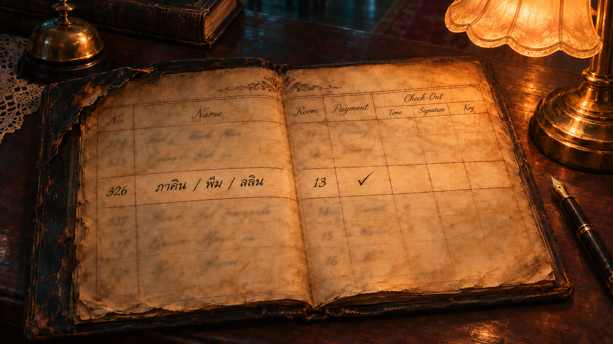
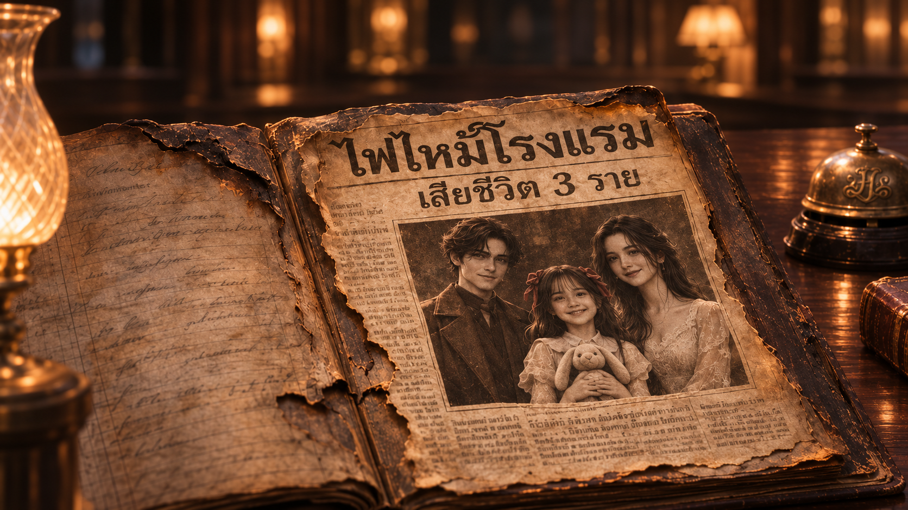
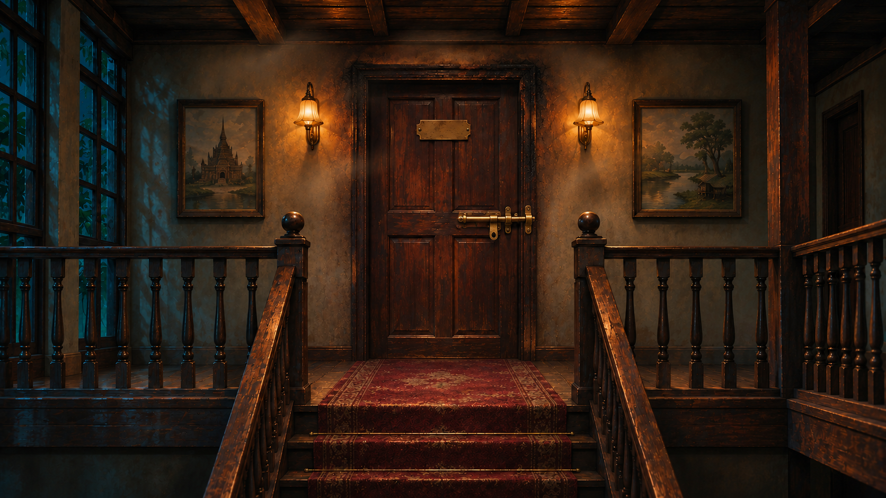
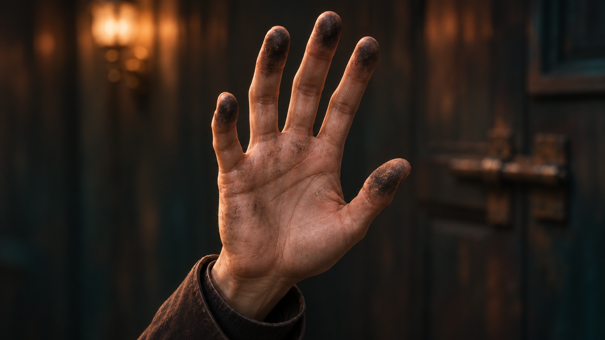

# ตรวจภาพชุด 04

[กลับหน้ารวม](README.md)

ภาพที่ยังไม่อนุมัติในหน้านี้ต้องรอผู้ใช้ตรวจ ก่อนนำไปตัดต่อเพิ่ม

## E02_charred_ledger_v2 — ทะเบียนขอบไหม้และช่องออกที่ยังว่าง

[เปิดภาพต้นฉบับ](../assets/E02_charred_ledger_v2.png)

## E03_news_family_v2 — ข่าวไฟไหม้และภาพครอบครัว

[เปิดภาพต้นฉบับ](../assets/E03_news_family_v2.png)

## E04_fire_corridor — กลอนด้านนอกของประตูทางเดิน

[เปิดภาพต้นฉบับ](../assets/E04_fire_corridor.png)

## E05_Phakhin_sad — ภาคินเล่าอดีต

[เปิดภาพต้นฉบับ](../assets/E05_Phakhin_sad.png)

## E06_burned_hand_v2 — ร่องรอยเขม่าที่ปลายนิ้วภาคิน

[เปิดภาพต้นฉบับ](../assets/E06_burned_hand_v2.png)

[ชุดถัดไป](batch_05.md)
