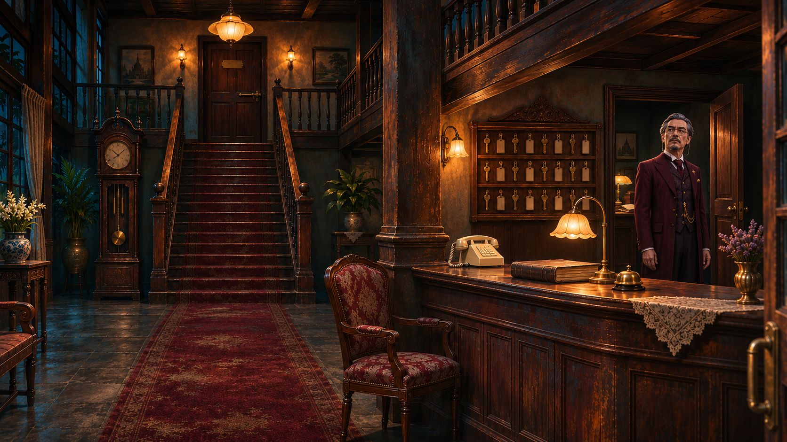
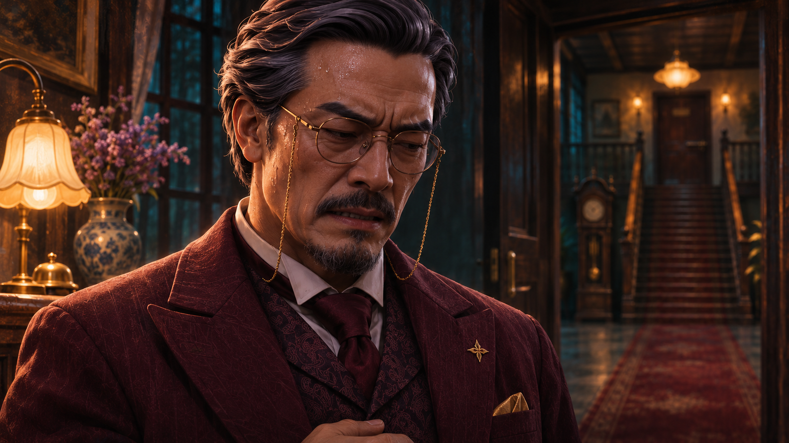

# ตรวจภาพชุด 05

[กลับหน้ารวม](README.md)

ภาพทุกภาพในหน้านี้ยังรอผู้ใช้ตรวจ ก่อนนำไปตัดต่อเพิ่ม

## F01_manager_office — ผู้จัดการปรากฏที่ประตูสำนักงาน

[เปิดภาพต้นฉบับ](../assets/F01_manager_office.png)

## F02_Maysa_confront — เมษาซักถามเรื่องประตูที่ถูกล็อก

[เปิดภาพต้นฉบับ](../assets/F02_Maysa_confront.png)

## F03_manager_guilt — ผู้จัดการเริ่มเสียการควบคุม

[เปิดภาพต้นฉบับ](../assets/F03_manager_guilt.png)

## F04_manager_takes_ledger — ผู้จัดการยึดสมุดและกุญแจ

[เปิดภาพต้นฉบับ](../assets/F04_manager_takes_ledger.png)

## G01_Maysa_exit — เมษาเกือบออกจากโรงแรม

[เปิดภาพต้นฉบับ](../assets/G01_Maysa_exit.png)

[ชุดถัดไป](batch_06.md)
