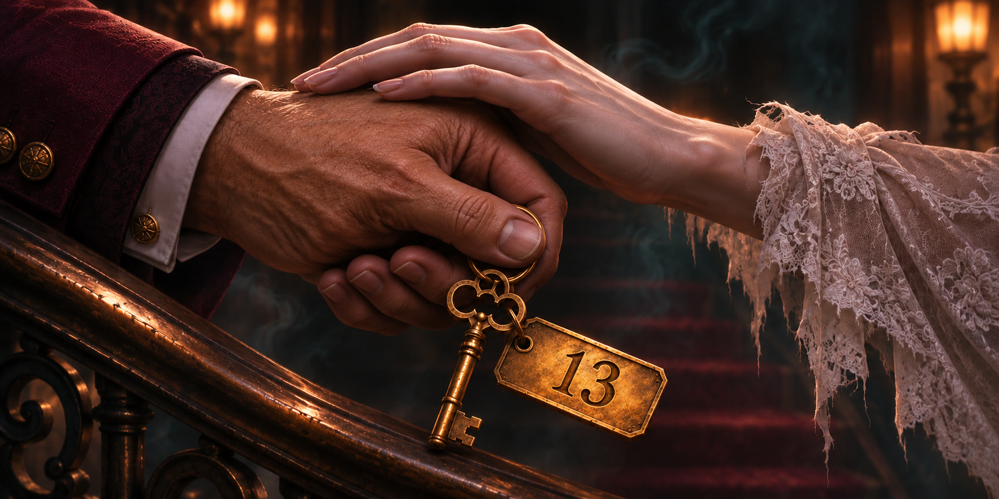
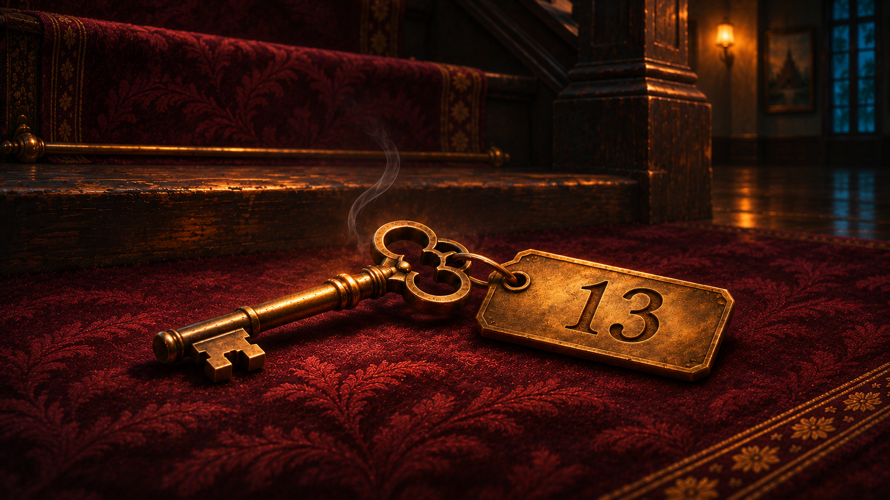
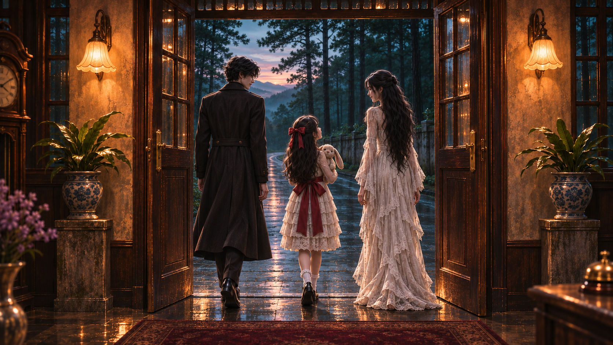

# ตรวจภาพชุด 08

[กลับหน้ารวม](README.md)

ภาพที่ยังไม่อนุมัติในหน้านี้ต้องรอผู้ใช้ตรวจ ก่อนนำไปตัดต่อเพิ่ม

## I03_Phakhin_blocks_v2 — ภาคินขวางผู้จัดการ

[เปิดภาพต้นฉบับ](../assets/I03_Phakhin_blocks_v2.png)

## I04_Pim_key_grip_v2 — มือผู้จัดการคลายกุญแจ — แก้นิ้วโป้งซ้ำ

[เปิดภาพต้นฉบับ](../assets/I04_Pim_key_grip_v2.png)

## I05_key_fallen — กุญแจตกบนพรม

[เปิดภาพต้นฉบับ](../assets/I05_key_fallen.png)

## I06_Maysa_returnskey_v2 — เมษานำกุญแจคืนแผง

[เปิดภาพต้นฉบับ](../assets/I06_Maysa_returnskey_v2.png)

## I07_family_exit — ครอบครัวออกจากโรงแรม

[เปิดภาพต้นฉบับ](../assets/I07_family_exit.png)

[ชุดถัดไป](batch_09.md)
