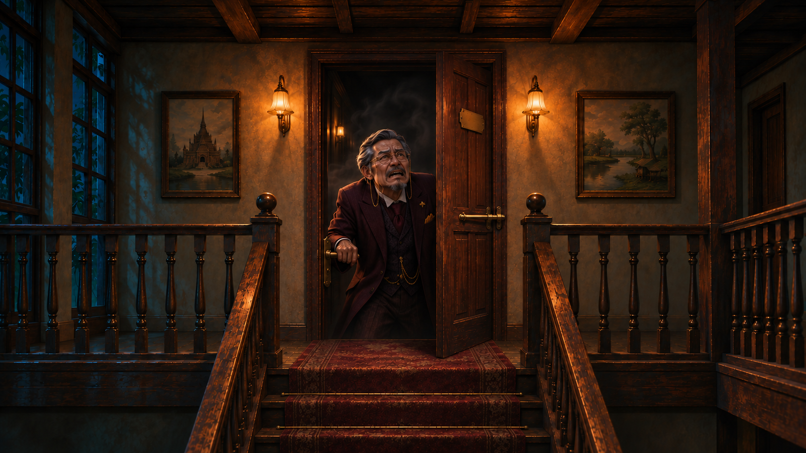
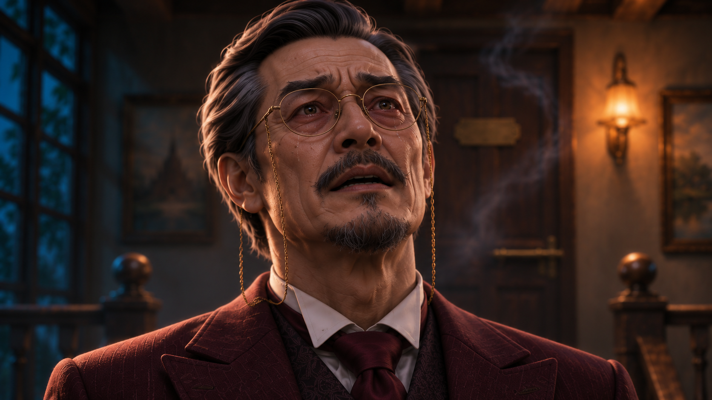
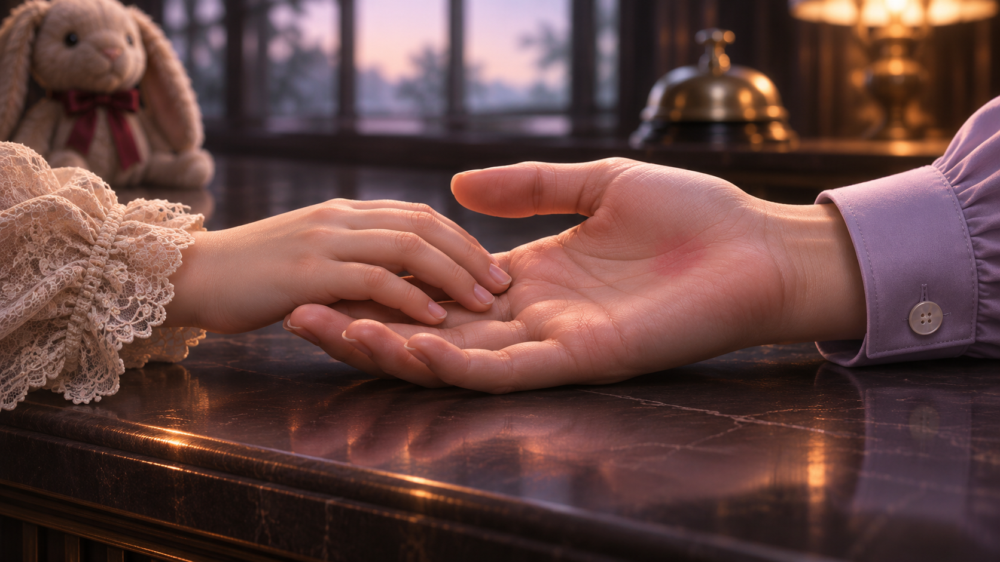
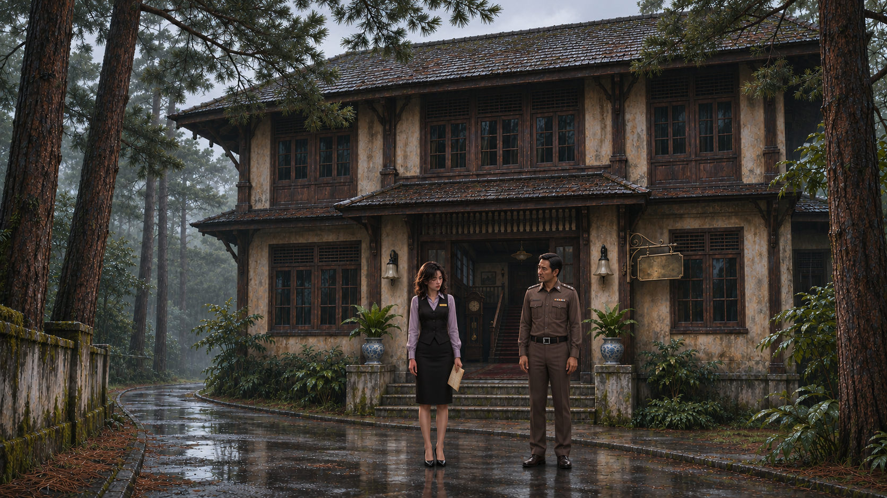
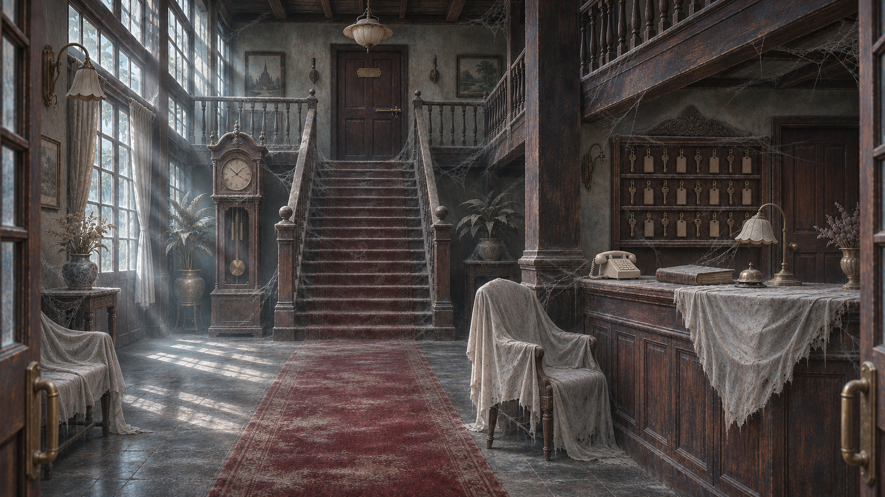

# ตรวจภาพชุด 09

[กลับหน้ารวม](README.md)

ผู้ใช้อนุญาตให้นำภาพที่ตรวจแล้วไปตัดต่อได้ เวอร์ชันที่เลิกใช้แยกอยู่ใน archive

## I08_manager_trapped_v2 — ผู้จัดการติดอยู่หลังประตู — เอามือที่ทะลุบานประตูออก

[เปิดภาพต้นฉบับ](../assets/I08_manager_trapped_v2.png)

## I09_manager_pleading — ภาพใกล้ผู้จัดการกล่าวขอโทษ

[เปิดภาพต้นฉบับ](../assets/I09_manager_pleading.png)

## I10_Lin_touch_hand — ลินแตะมือเมษาก่อนจากไป

[เปิดภาพต้นฉบับ](../assets/I10_Lin_touch_hand.png)

## J01_police_Maysa — J01_police_Maysa

[เปิดภาพต้นฉบับ](../assets/J01_police_Maysa.png)

## J02_abandoned_lobby — J02_abandoned_lobby

[เปิดภาพต้นฉบับ](../assets/J02_abandoned_lobby.png)

[ชุดถัดไป](batch_10.md)
