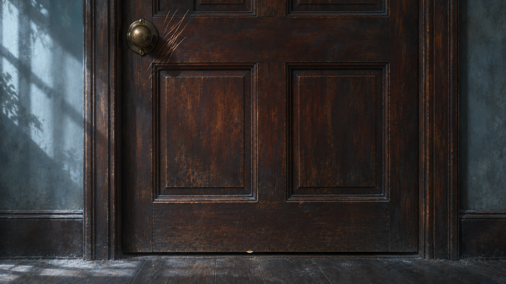
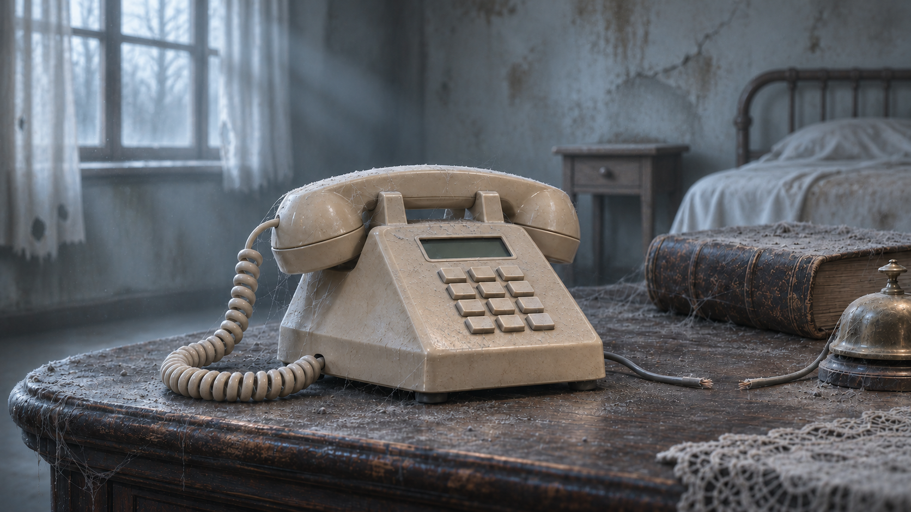
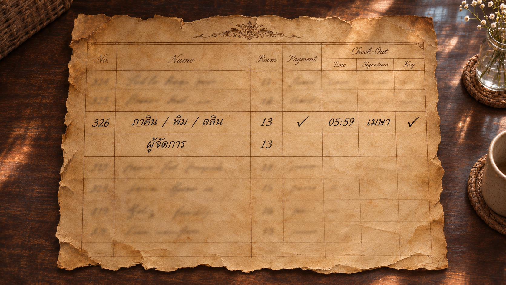

# ตรวจภาพชุด 10

[กลับหน้ารวม](README.md)

ผู้ใช้อนุญาตให้นำภาพที่ตรวจแล้วไปตัดต่อได้ เวอร์ชันที่เลิกใช้แยกอยู่ใน archive

## J03_scratched_door — J03_scratched_door

[เปิดภาพต้นฉบับ](../assets/J03_scratched_door.png)

## J04_cut_phone_v2 — J04_cut_phone_v2

[เปิดภาพต้นฉบับ](../assets/J04_cut_phone_v2.png)

## J05_Maysa_home_ledger — J05_Maysa_home_ledger

[เปิดภาพต้นฉบับ](../assets/J05_Maysa_home_ledger.png)

## J06_new_ledger_entry — J06_new_ledger_entry

[เปิดภาพต้นฉบับ](../assets/J06_new_ledger_entry.png)

## J07_phone13 — J07_phone13

[เปิดภาพต้นฉบับ](../assets/J07_phone13.png)

[ชุดถัดไป](batch_11.md)
