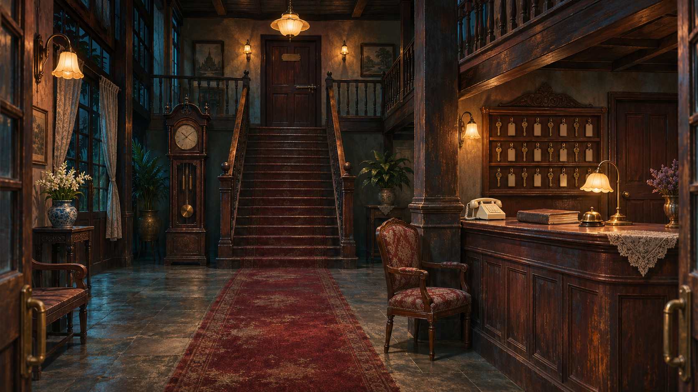
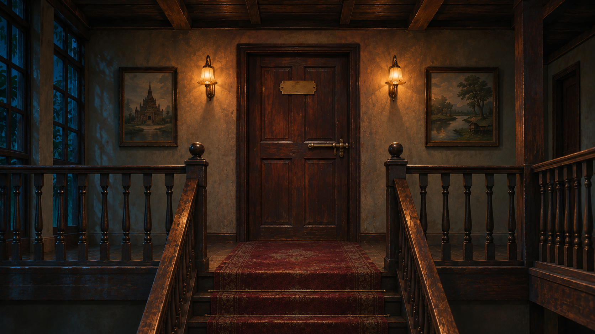
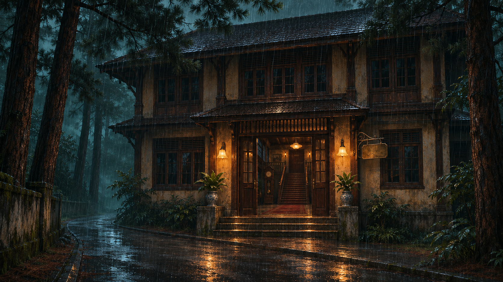

# Hotel 13 — ภาพต้นแบบสถานที่

ภาพจริงที่สร้างใน ChatGPT ใช้เป็นภาพอ้างอิงสำหรับช็อตถัดไป ทั้งหมดไม่มีตัวละคร ภาพใกล้ 16:9 ขนาด 1672×941; ตอนส่งออกต้องครอปเล็กน้อยให้ตรง 1920×1080 ห้ามยืดสัดส่วน

## ล็อบบี้

เคาน์เตอร์ขวา บันไดกลาง นาฬิกาซ้าย ประตูสำนักงานขวาสุด ใช้เป็น master หลัก

## ชานพัก

ประตูทางเดินห้อง 13 กลอนอยู่ด้านนอกฝั่งชานพัก ป้ายเว้นว่างสำหรับใส่เลขในตัดต่อ

## ภายนอก

โรงแรมสองชั้น ไฟหน้าประตูสองดวง ถนนฝนตก ไม่มีรถส่วนตัวเมษา

ยังไม่ใช่ภาพประกอบครบทุกช็อต และยังไม่มีตัวละครจาก sheets อยู่ในภาพเหล่านี้
